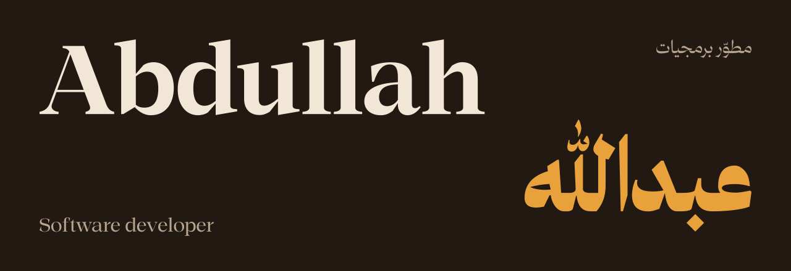
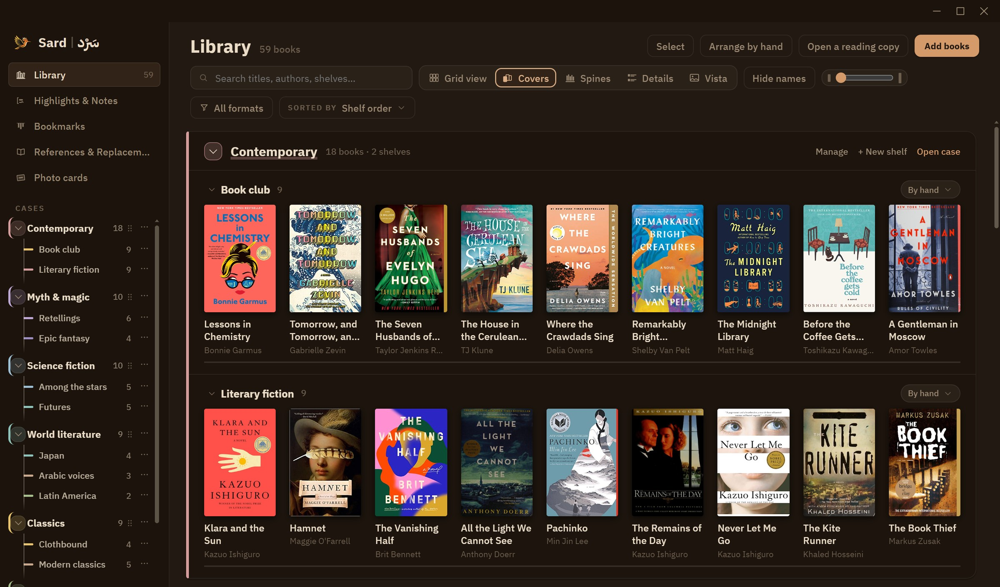

I build desktop software for reading. Most of my time goes into **Sard**, a native ebook reader
with a Rust core, a React front end and a local SQLite library, and into the small tools around it.

## Sard · سَرْد

A desktop reader for EPUB and PDF, built around one idea: a page resting on a desk, and nothing
between you and it.

- Cases and shelves in your own colours, five ways to view the library, covers and metadata filled in on import
- Typography set per script — face, size, leading, margins and page width — in either reading direction
- Read-aloud that runs offline, with the spoken sentence and word highlighted as it goes
- Annotations, references, photo cards, spoiler-safe search and sixteen themes
- One local SQLite file: no account, no sync service, no telemetry

**[Explore Sard](https://github.com/Limitless-Soul1/Sard)** · [Latest release](https://github.com/Limitless-Soul1/Sard/releases/latest)

## Other work

- **[PyScope](https://github.com/Limitless-Soul1/PyScope)** — a lightweight GUI for managing Python packages across venv, Conda and system environments.
- **[FLUX text-to-image workflow](https://github.com/Limitless-Soul1/Flux-Text-to-image-Workflow)** — a ComfyUI workflow for FLUX.1 with modular LoRA stacking and dynamic resolution scaling.
- **[Online bookstore](https://github.com/Limitless-Soul1/bookstore-project)** — catalogue, cart and an inventory dashboard in PHP and MySQL.

## Tools

Rust and TypeScript on the desktop, with Tauri and React. Python for tooling and speech. SQLite for storage.
